# ClickLens

A single-binary tool with a built-in web UI to analyze ClickHouse query executions. Connect to any ClickHouse instance, explore query logs, drill into CPU/memory/IO usage per thread, view flame graphs, compare queries side by side, and run ad-hoc SQL.

## Features

- **System Dashboard** — Overview of uptime, active queries/merges/parts, database sizes, top tables by size and part count, system metrics and events. Replica status and replication queue for clusters.
- **Replication** — Dedicated monitoring of `system.replicas`, `system.replication_queue`, pending `system.mutations`, and Keeper session health, with summary stat cards, 24h activity charts from `system.metric_log`, action-item badges, filters (database / errors-only / executing), and opt-in live auto-refresh.
- **DDL** — Distributed DDL queue (`system.distributed_ddl_queue`) and recent schema operations from `system.query_log`, surfacing stuck/failed `ON CLUSTER` DDL at a glance, with a configurable timeframe and ops-over-time chart.
- **Mutations** — Active `system.mutations` (`ALTER … UPDATE/DELETE/TTL` data rewrites) with parts-to-do, age, and failure detail, plus `KILL MUTATION`.
- **Merges** — In-progress part merges (`system.merges`) with progress, bytes, and elapsed; opt-in live auto-refresh.
- **System Metrics** — Searchable, categorized asynchronous gauges (`system.asynchronous_metrics`) with a per-node view on clusters.
- **Query List** — Browse, filter, sort, and paginate through `system.query_log` including failed queries
- **Query Detail** — Overview with RAM/CPU/IO time-series charts, top ProfileEvents, thread breakdown with role inference, memory analysis, storage I/O stats, and settings
- **Flame Graphs** — Canvas-based flame graphs from `system.trace_log` (Memory/MemorySample/MemoryPeak/CPU/Real) with auto-detection of available trace types
- **Visual EXPLAIN** — Interactive collapsible tree view of the execution plan, plus raw pipeline and syntax views
- **Thread Breakdown** — Per-thread role inference (Coordinator, Scan+Filter, Aggregator, I/O Pool), pipeline visualization from EXPLAIN PIPELINE, top DB functions from trace data
- **Query Fingerprints** — Group queries by `normalized_query_hash`, view aggregated stats (count, avg/P50/P95 latency, memory, I/O), drill into per-fingerprint performance trends over time
- **Running Queries** — Live view of `system.processes` with auto-refresh, kill query support
- **SQL Editor** — CodeMirror 6 editor with schema browser sidebar, column type display, copy-on-hover cells, and "View Analysis" link to jump to profiling data
- **Saved Queries** — Save, load, search, import, and export queries. Saved queries are stored in browser localStorage and organized in an accordion sidebar panel.
- **Parameterized Queries** — Use `{{param_name}}` syntax in any query to define parameters. Parameter input fields appear automatically in the sidebar. Values are substituted at execution time. Escape with `\{{` for literal `{{`.
- **Query Comparison** — Side-by-side diff of two queries including ProfileEvents metrics
- **Users & Access** — Browse users, roles, grants, and quota usage (`system.users`/`roles`/`grants`/`quotas`/`quota_usage`); read-only plus permission-gated manage actions (DROP USER/ROLE, REVOKE).
- **Cluster Support** — Auto-detects `system.clusters`, uses `clusterAllReplicas`
- **Table Optimizer** — Analyze single tables, entire databases, or all databases for ClickHouse optimization opportunities including LowCardinality, integer right-sizing, Nullable removal, ORDER BY/PARTITION BY suggestions, skipping indices, codec recommendations, and table health checks. Generates copy-ready ALTER TABLE DDL. Bulk analysis streams results in real-time via SSE. On ClickHouse ≥ 26.6, skipping-index suggestions are **measured, not guessed**: a session-scoped hypothetical index + `EXPLAIN WHATIF` reports the projected granule skip ratio right on the recommendation card.
- **Remote-Table Advisor** — Queries that touch S3/URL/Iceberg/… engine tables get an inline warning (remote scans are slow and expensive), with one-click "Add LIMIT 1000" / "Limit to 5 min" actions and per-table 24h read stats.
- **ClickHouse 26 features** — version-gated with graceful fallbacks: `EXPLAIN ANALYZE` (26.7), pretty EXPLAIN output (26.3+), `EXPLAIN WHATIF` + hypothetical indexes (26.6), automatic fallback to `system.user_query_log` when full `query_log` access is denied (26.8), and per-statement server-side query parameters (no version requirement) that replace `{{param}}` string substitution with properly bound values.

## Screenshots

### System Dashboard
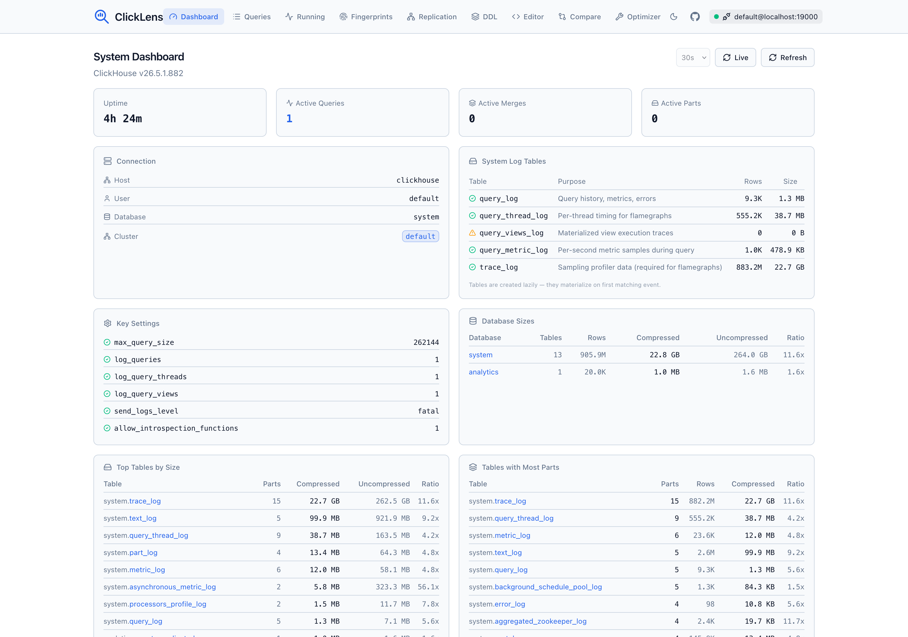

### Queries
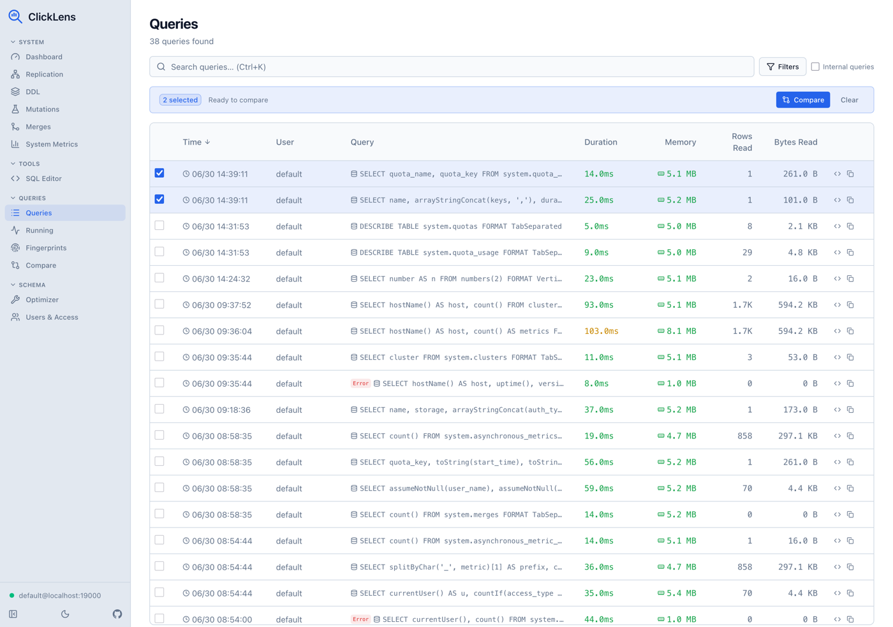

### Query Detail
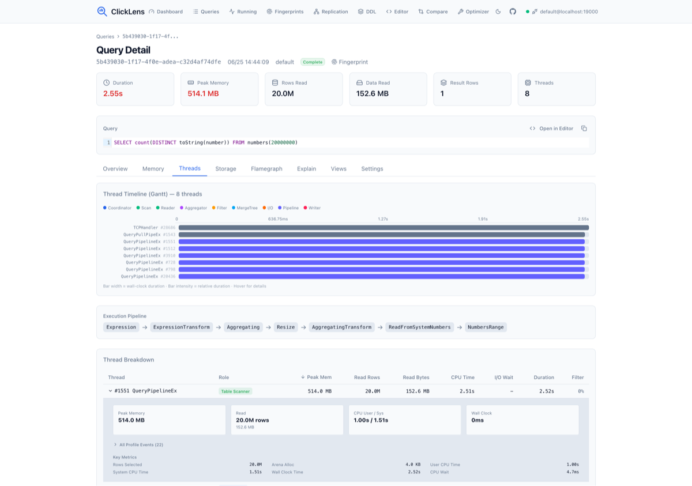

### Query Fingerprints
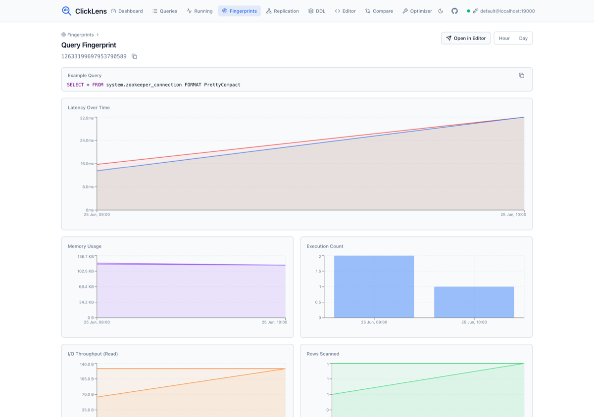

### Replication
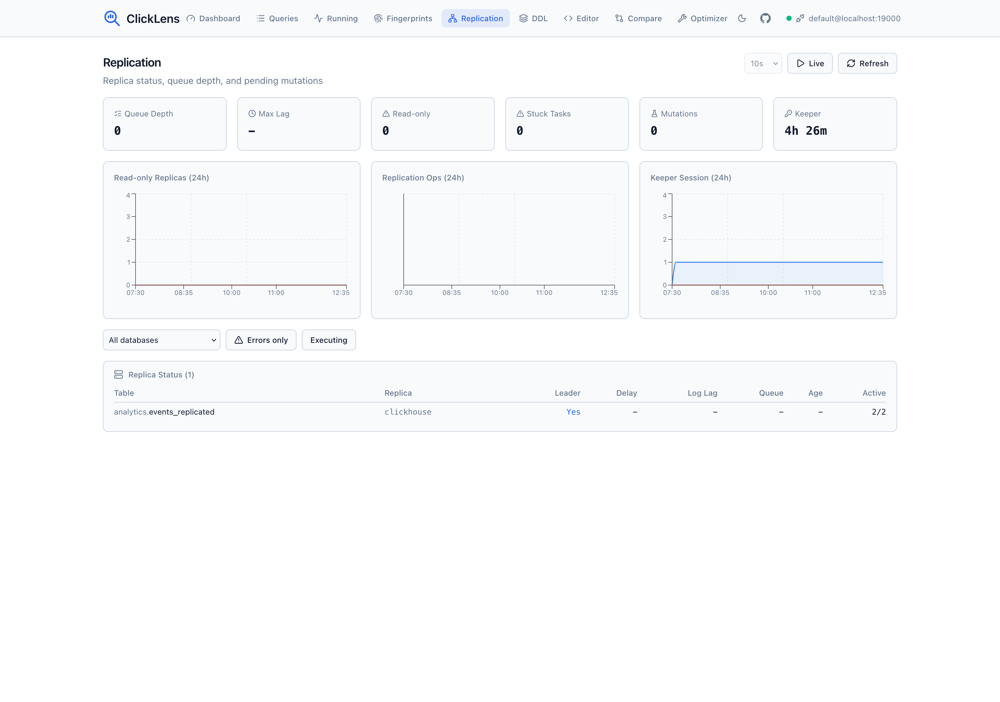

### DDL
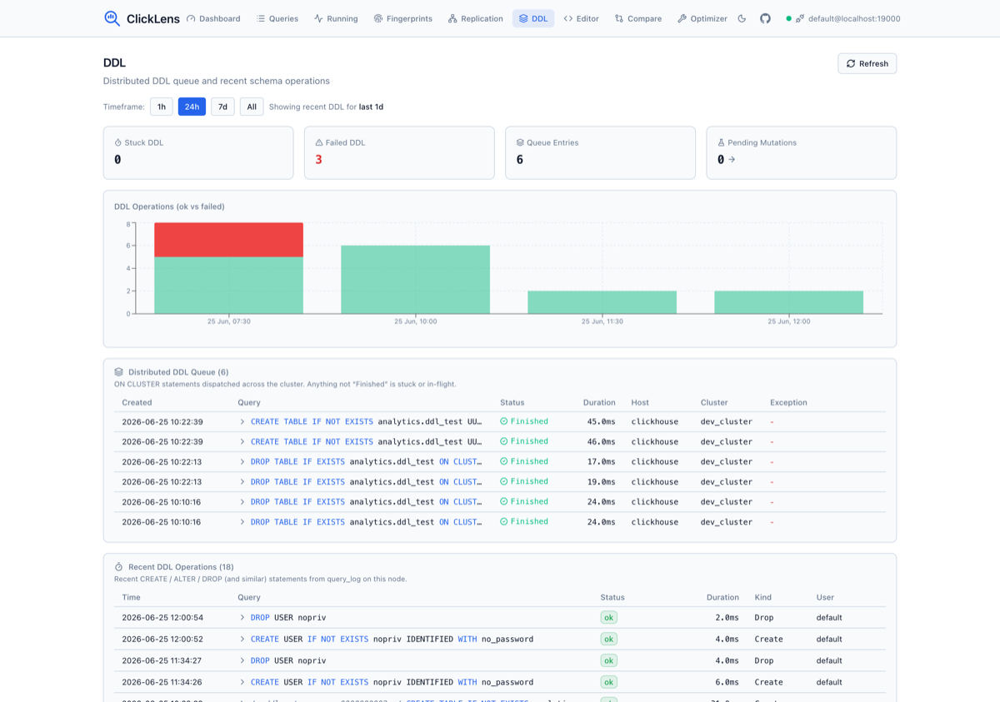

### Merges
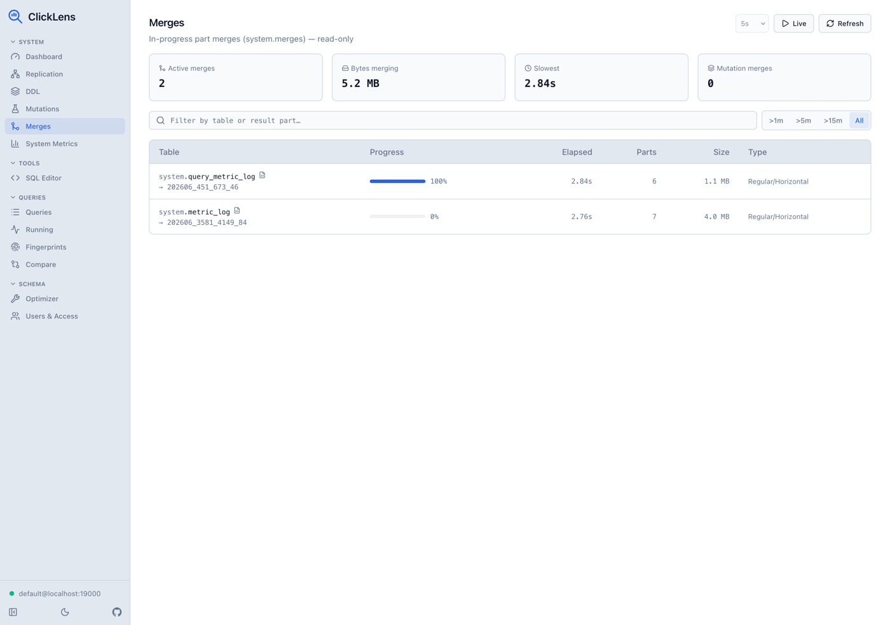

### SQL Editor
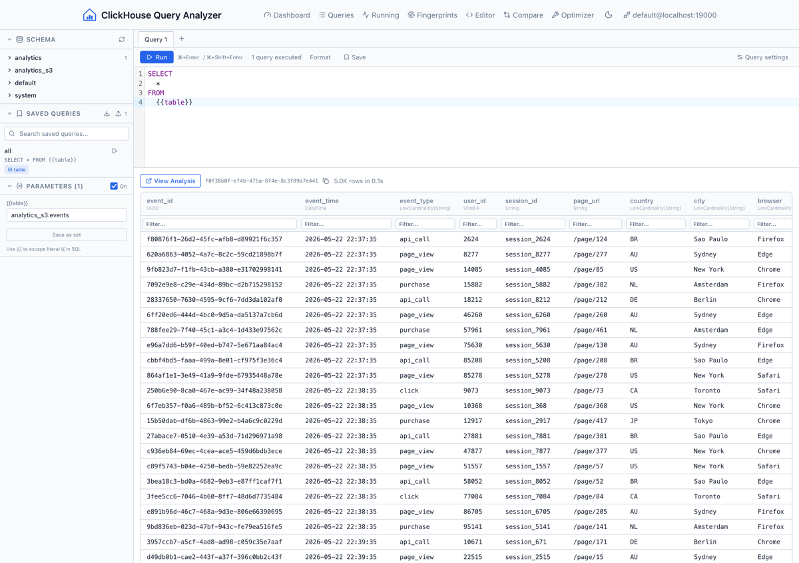

### Query Comparison
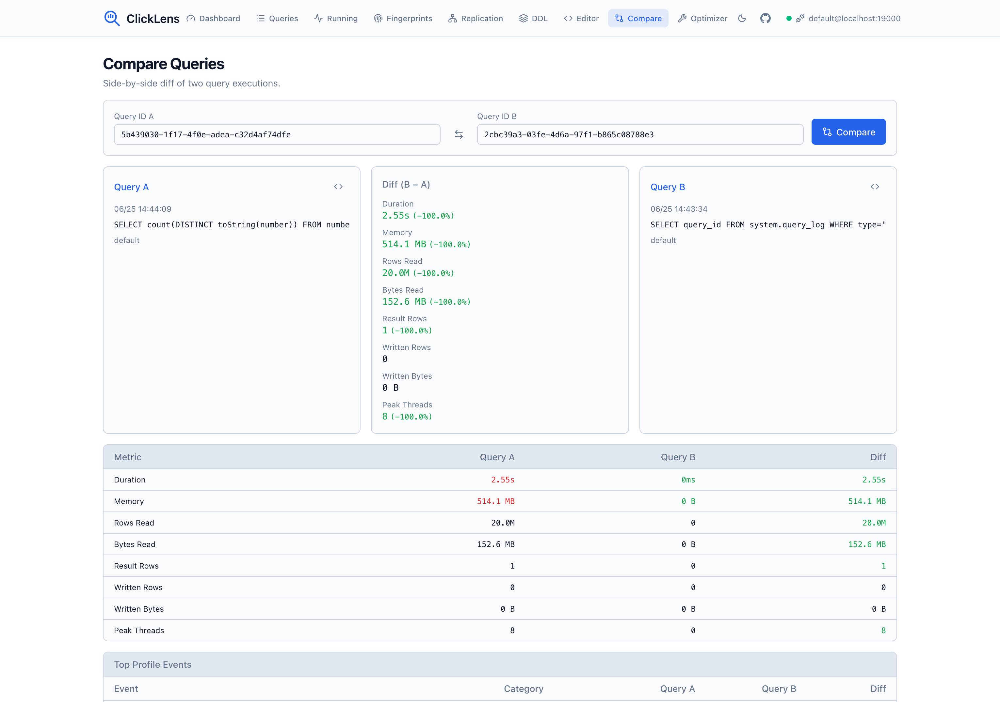

### Table Optimizer
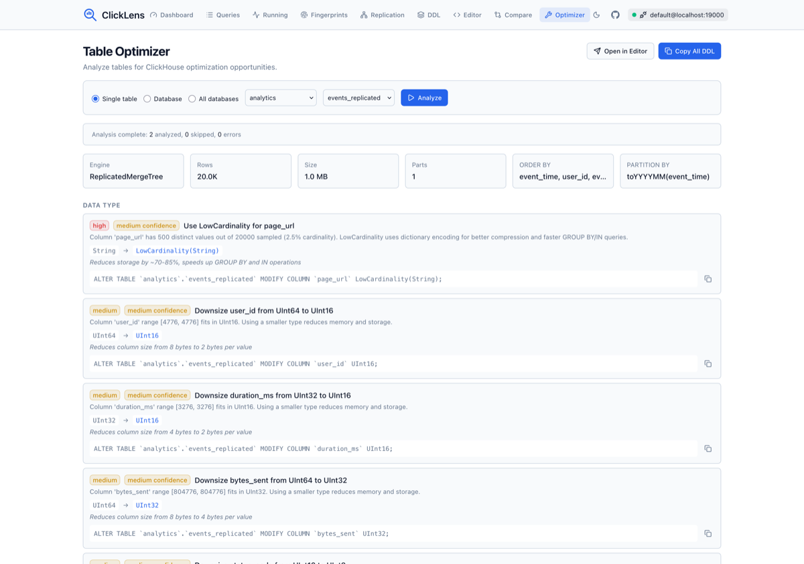

### Users & Access
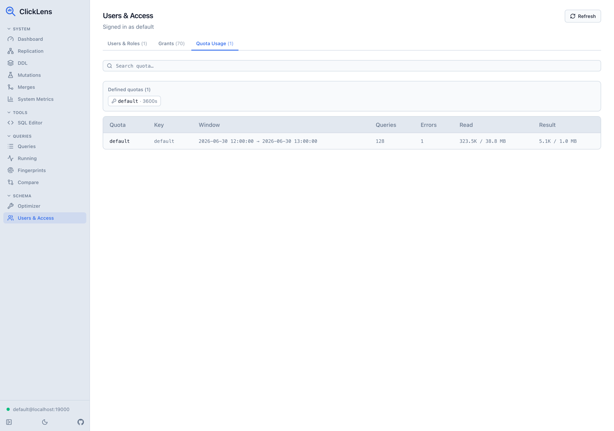

## Quick Start

### Docker

```bash
docker pull ghcr.io/nimbleflux/clickhouse-query-analyzer:latest
docker run -p 8080:8080 ghcr.io/nimbleflux/clickhouse-query-analyzer:latest
```

Open http://localhost:8080 and enter your ClickHouse connection details in the top bar.

### Binary

Download from [Releases](https://github.com/nimbleflux/clickhouse-query-analyzer/releases) for your platform:

```bash
# Linux/macOS
chmod +x clickhouse-query-analyzer-*
./clickhouse-query-analyzer-linux-amd64 -port 8080
```

### Build from Source

```bash
make build
./clickhouse-query-analyzer
```

## Connection

The tool connects to ClickHouse through its Go backend — no ClickHouse credentials are stored server-side (unless the operator configures defaults via env vars, see Security below). Supported URL schemes:

| Scheme | Protocol | TLS |
|--------|----------|-----|
| `clickhouse://host:9000` | Native TCP (driver conns) | No |
| `clickhouses://host:9440` | Native TCP (driver conns) | Yes |
| `http://host:8123` | HTTP API | No |
| `https://host:8443` | HTTP API | Yes |

Protocol note: SQL Editor statements are executed via ClickHouse's HTTP interface regardless of scheme — `clickhouse://host:9000` is transparently mapped to `http://host:8123` (native port − 877) so you only enter one URL. All other pages (query log, dashboard, flame graphs, …) use the native driver connection. Every editor statement carries a pre-generated `query_id`: the UI streams live progress from `system.processes` while it runs, and Stop issues a precise `KILL QUERY` for it.

**Slow-query behavior**: an ad-hoc statement gets a server-side budget (`-query-timeout`, default 120s) and its response is streamed as newline-delimited JSON events (started → progress → result), so reverse proxies in front of ClickLens see bytes immediately and won't fire their read timeouts on long queries. The full row count is **not** computed automatically anymore (it silently doubled the cost of heavy queries — e.g. a second full S3 scan); the result header offers an explicit "Count all rows" action instead.

For self-signed certificates, check "Skip TLS verify" in the connection bar.

### TLS Certificates for ClickHouse Connections

ClickLens connects to ClickHouse from the browser, so TLS certificates must be trusted by the **client browser** (or the system running the browser), not by the ClickLens server.

- **Trusted CA** — If ClickHouse uses a certificate from a public CA (e.g. Let's Encrypt), no extra steps are needed.
- **Internal / self-signed CA** — Install the CA certificate on each machine running the browser:
  - **macOS**: Add to Keychain → System keychain → set to "Always Trust"
  - **Linux**: Copy to `/usr/local/share/ca-certificates/` and run `sudo update-ca-certificates`
  - **Windows**: Import into "Trusted Root Certification Authorities" via certmgr.msc
- **Skip TLS verify** — For development or air-gapped environments, check "Skip TLS verify" in the connection bar. This disables certificate validation for that connection.
- **Docker** — When running ClickLens behind a reverse proxy (nginx, Caddy, Traefik) that terminates TLS, mount the certificate and key into the proxy container. Example for nginx:

  ```yaml
  services:
    clicklens:
      image: ghcr.io/nimbleflux/clickhouse-query-analyzer:latest
      ports:
        - "8080:8080"
    nginx:
      image: nginx:alpine
      ports:
        - "443:443"
      volumes:
        - ./nginx.conf:/etc/nginx/nginx.conf:ro
        - ./certs/tls.crt:/etc/nginx/tls.crt:ro
        - ./certs/tls.key:/etc/nginx/tls.key:ro
  ```

## Dev Environment

```bash
# Start a single ClickHouse node with sample data (the default — lightest setup)
make dev-clickhouse
make seed

# Run with hot-reload frontend
make dev
```

The dev ClickHouse runs on ports 18123 (HTTP) and 19000 (native) to avoid conflicts with existing instances. Connect using `clickhouse://localhost:19000` or `http://localhost:18123`.

The default `make dev-clickhouse` starts a single ClickHouse node only — no external dependencies. The replication demo stack (2nd node + Keeper) and the S3 stack (MinIO + S3 storage disk) are opt-in profiles:

```bash
# Replication + DDL dashboards: a 2nd node + Keeper, then seed ReplicatedMergeTree
make dev-clickhouse-repl
make seed-replication
```

`make seed-replication` auto-starts the replication stack, so it also works as a one-shot. The second replica has no host ports — it's reached over the internal Docker network for replication only.

```bash
# S3 stack: MinIO + a ClickHouse node with the S3 disk (ports 18223/19100),
# for the remote-table advisor and S3-engine demos
make dev-clickhouse-s3
docker exec -i dev-clickhouse-s3-1 clickhouse-client < dev/seed-s3.sql
```

> **Note on the S3 stack:** MinIO removed its public container images (the Docker Hub repo was deleted and the quay.io repo now requires auth), so `make dev-clickhouse-s3` only works if you already have the images locally or can pull them from a registry you have access to. The default and replication stacks are unaffected.

## Setup & Diagnostics

ClickLens requires certain ClickHouse settings and log tables to be enabled for full functionality. The **Dashboard** page surfaces live diagnostics — connection info, log table status, key settings, and actionable warnings.

### Required Settings

Add these to your ClickHouse server config (`config.xml` or `users.xml`):

```xml
<!-- Enable query logging -->
<log_queries>1</log_queries>

<!-- Enable thread-level profiling -->
<log_query_threads>1</log_query_threads>

<!-- Enable materialized view logging (optional) -->
<log_query_views>1</log_query_views>

<!-- Enable detailed metric logging (optional) -->
<log_query_metrics>1</log_query_metrics>

<!-- Required for flamegraphs -->
<allow_introspection_functions>1</allow_introspection_functions>

<!-- Enable sampling profiler (for flamegraphs) -->
<log_profiler_events>1</log_profiler_events>
```

### Log Table Sizing

ClickLens queries these `system.*` log tables:

| Table | Purpose | Recommended Retention |
|-------|---------|----------------------|
| `system.query_log` | Query history, metrics, errors | 7-30 days |
| `system.query_thread_log` | Per-thread timing for flamegraphs | 7-30 days |
| `system.query_views_log` | Materialized view execution | 7-30 days |
| `system.query_metric_log` | Per-second metrics during query | 1-7 days |
| `system.trace_log` | Sampling profiler data | 1-7 days |

For large deployments, configure TTL to manage disk usage:

```sql
ALTER TABLE system.query_log MODIFY TTL event_time + INTERVAL 14 DAY;
ALTER TABLE system.query_thread_log MODIFY TTL event_time + INTERVAL 14 DAY;
ALTER TABLE system.trace_log MODIFY TTL event_time + INTERVAL 7 DAY;
```

The **Dashboard** page shows current row counts and on-disk sizes for these tables, plus warnings for empty or missing tables. Each missing table has an inline "enable" toggle that reveals the exact XML snippet to add to your `config.xml`.

## Architecture

- **Backend**: Go with Chi router, `clickhouse-go/v2` driver (native + HTTP), stateless connection pool
- **Frontend**: React + TypeScript + Vite + Tailwind CSS + Recharts + CodeMirror 6
- **Single binary**: Frontend embedded via `//go:embed`, served as static files
- **Stateless**: Connection params sent via `X-CH-*` headers per request, backend pools connections keyed by URL+user+db

## Security

ClickLens is a developer tool, not a multi-tenant application. The backend has **no built-in authentication**. You must understand the following before deploying:

### Must do

- **Put ClickLens behind an authenticating reverse proxy** (nginx, Caddy, OAuth2 Proxy, Cloudflare Access, etc.). The app itself does not authenticate users. Without a proxy, anyone who can reach the port can run arbitrary SQL against your ClickHouse.
- **Use TLS**. ClickHouse passwords are sent as HTTP headers on every request. Without TLS (HTTPS), they traverse the network in cleartext. Use a reverse proxy or load balancer that terminates TLS.
- **Bind to `127.0.0.1`** if running locally (`-port 8080` binds to `0.0.0.0` by default; use a reverse proxy to restrict access).

### Security model and limitations

- **No authentication**: There is no auth middleware. Every API endpoint is open. The operator-configured `CLICKHOUSE_URL` / `CLICKHOUSE_PASSWORD` env vars are used as fallback for any unauthenticated request that omits `X-CH-URL`, meaning an exposed instance gives attackers full SQL access to your ClickHouse.
- **Read-only mode is advisory, not a security boundary**: The "Read only" toggle in the connection bar sends an `X-CH-Readonly: 1` header. This is a UX convenience that blocks obvious write statements (INSERT, DROP, ALTER, etc.). It is **trivially bypassable** by omitting the header or using statement forms the prefix-check doesn't catch (comments, CTEs, SET). For real read-only enforcement, create a read-only ClickHouse user and connect with those credentials.
- **CORS defaults to same-origin**: By default, no CORS headers are emitted, so the API is only accessible from the same origin. Use `-cors-origin` or `CORS_ORIGIN` to allow a specific trusted origin. Using `*` allows cross-origin requests but does **not** advertise the `X-CH-*` credential headers, preventing cross-origin CSRF.
- **Password stored in browser localStorage**: The connection form persists credentials (including password) in `localStorage` for convenience. This is readable by browser extensions and any XSS on the origin. Clear localStorage after use on shared machines.
- **SSRF**: The app connects to whatever ClickHouse URL the user provides. An attacker can point it at internal hosts (metadata endpoints, other databases). Restrict network access at the infrastructure level.
- **Security headers**: The app sets `X-Content-Type-Options: nosniff`, `X-Frame-Options: DENY`, and `Referrer-Policy: no-referrer`. Add a `Content-Security-Policy` via your reverse proxy for full coverage.

### Built-in protections

- Request body size limited to 1 MB
- SQL query result rows capped (server-side pagination, `max_result_rows` enforced after user settings)
- Trace log queries capped at 10,000 rows
- Prometheus metrics use route patterns (not raw URLs) to prevent cardinality explosion
- ClickHouse passwords are never logged (connection URLs are redacted before logging; the SHA-256 hash is only used as an internal pool key)
- The `/api/config` endpoint does not expose the password (only a `has_password` boolean)
- POST endpoints require `Content-Type: application/json`, which blocks blind cross-origin "simple request" CSRF
- Editor queries only accept a whitelisted set of ClickHouse settings (e.g. `max_execution_time`, `max_threads`, `query_plan_*`) — notably `log_comment` cannot be overridden, so ClickLens-internal query tagging can't be spoofed

### Flags

| Flag | Env | Default | Purpose |
|------|-----|---------|---------|
| `-port` | `PORT` | `8080` | HTTP server port |
| `-clickhouse-url` | `CLICKHOUSE_URL` | — | Default ClickHouse URL for clients that omit `X-CH-URL` |
| `-clickhouse-user` | `CLICKHOUSE_USER` | `default` | Default username |
| `-clickhouse-password` | `CLICKHOUSE_PASSWORD` | — | Default password |
| `-clickhouse-db` | `CLICKHOUSE_DB` | `system` | Default database |
| `-query-timeout` | `QUERY_TIMEOUT` | `120s` | Per-statement budget for SQL editor queries and single-table analyses |
| `-bulk-analysis-timeout` | `BULK_ANALYSIS_TIMEOUT` | `30m` | Budget for bulk table-analysis streams |
| `-cors-origin` | `CORS_ORIGIN` | — | Allowed CORS origin (empty = same-origin only) |
| `-dev` | — | `false` | Development mode (proxy frontend to Vite) |

## License

MIT
